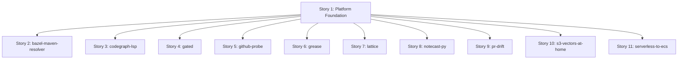

# Software Catalog - Implementation Stories

**Spec:** [../spec.md](../spec.md)
**Architecture:** [../architecture.md](../architecture.md)

## Summary

Stand up a real Backstage.io instance in this repo and register all 11 owned repos (10 sibling repos + `backstage` itself) as Components in its Software Catalog, with accurate metadata pulled from `exploration.md`. Story 1 builds the platform itself (scaffold, guest auth, GitHub-wide discovery, TechDocs, owner User entity) and self-registers `backstage`. Stories 2–11 each register one external sibling repo — bundling in any repository fix that repo needs (license, module path, or missing CI/CD) so every repo gets touched exactly once.

## Story Dependencies

## Story Overview

| Story | Name | Depends On |
|-------|------|------------|
| 1 | Platform foundation | - |
| 2 | Register bazel-maven-resolver (+ MIT license) | 1 |
| 3 | Register codegraph-lsp | 1 |
| 4 | Register gated (+ relicense to Apache-2.0) | 1 |
| 5 | Register github-probe | 1 |
| 6 | Register grease (+ fix Go module path) | 1 |
| 7 | Register lattice (+ standalone MIT license) | 1 |
| 8 | Register notecast-py | 1 |
| 9 | Register pr-drift | 1 |
| 10 | Register s3-vectors-at-home (+ MIT license) | 1 |
| 11 | Register serverless-to-ecs (+ MIT license + CI/CD) | 1 |

Stories 2–11 have no dependencies on each other and can be implemented in any order once Story 1 is done. Per `architecture.md`, each external-repo story lands on a `feature/software-catalog` branch with a commit in that repo — no push, no PR, per explicit user instruction.
